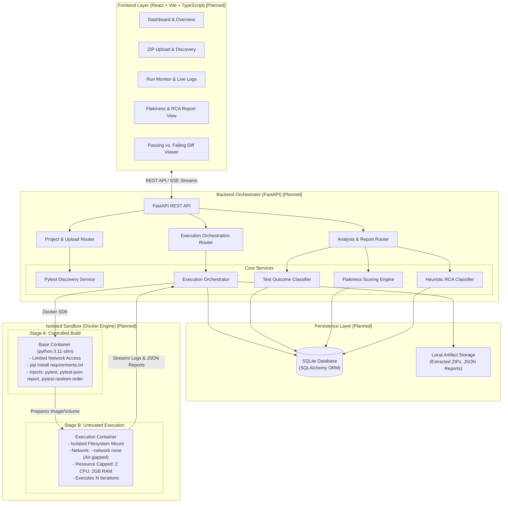
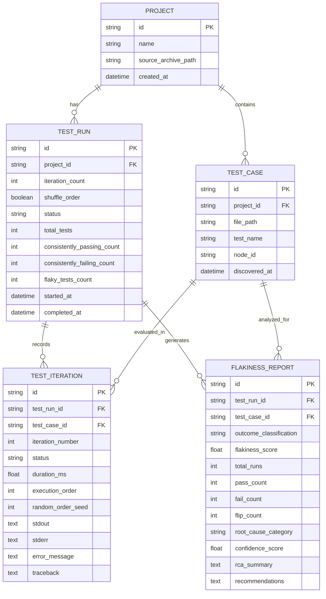

# FLAKELENS

> **Automated Flaky Test Detection & Root Cause Analysis Platform**

> ⚠️ **Project Status: Architectural Specification & Planning Stage**  
> All components, features, modules, and interfaces documented in this specification are **planned** and **not yet implemented**. Active software development will begin only following architectural review and approval.

---

## 1. Project Title & Overview

**FLAKELENS** is an automated testing diagnostics platform designed to detect, classify, and analyze flaky (non-deterministic) tests in software applications. Focused initially on Python projects using the `pytest` testing framework, FLAKELENS executes test suites across repeated iterations in isolated sandbox environments, collects structured execution evidence, categorizes test outcomes, and suggests root causes using heuristic telemetry analysis.

By isolating phantom failures from deterministic bugs and quantifying stability, FLAKELENS restores confidence in continuous integration, reduces developer debugging cycles, and prevents intermittent test noise from masking genuine regressions.

---

## 2. Problem Statement

Continuous integration (CI) environments depend on deterministic test suites to validate code quality. However, software test suites frequently suffer from **flaky tests**—tests that exhibit both passing and failing outcomes across repeated executions without any changes to the underlying application source code or test definitions.

Flaky tests introduce non-deterministic noise into the engineering lifecycle. Because their failure is intermittent, developers struggle to reproduce them locally. Consequently, teams often ignore failed test runs, repeatedly trigger manual CI rebuilds until tests pass by chance, or disable tests entirely. This masks real software regressions, slows delivery velocity, and undermines engineering trust in automated verification systems.

---

## 3. Why Flaky Tests Are a Problem

| Impact Area | Consequences |
| :--- | :--- |
| **Developer Productivity** | Engineers spend hours investigating false alarms, context-switching away from feature delivery to chase phantom bugs. |
| **Release Velocity** | Blocked pipelines and repeated manual re-runs delay deployments and inflate continuous integration cycles. |
| **Masked Regressions** | A genuine bug masked as an intermittent "known flake" can be ignored and deployed directly into production. |
| **Cloud & Infrastructure Cost** | Repeatedly re-triggering CI/CD pipelines to achieve an accidental pass consumes substantial compute credits and runner capacity. |
| **Erosion of Test Trust** | When red builds are routinely dismissed as "just flaky," the entire safety net of automated testing loses its value. |

---

## 4. Project Objectives

1. **Automate Flakiness Detection**: Provide an automated runner that executes Python `pytest` suites repeatedly ($N$ iterations) in controlled, containerized environments.
2. **Accurately Classify Test Outcomes**: Distinctly categorize tests into **Consistently Passing**, **Consistently Failing (Deterministic Failures)**, and **Flaky (Intermittent)** tests—ensuring broken tests are never mislabeled as stable.
3. **Capture Comprehensive Execution Telemetry**: Record execution durations, stdout, stderr, exception types, and stack traces for every individual test iteration.
4. **Identify Probable Root Causes via Evidence**: Leverage rule-based heuristic analyzers to diagnose failure patterns (e.g., test order dependencies, timing/timeout races, or resource/state leaks).
5. **Present Actionable Insights**: Deliver an intuitive web dashboard featuring flakiness rankings, visual execution timelines, passing vs. failing run diffs, and remediation advice.
6. **Enforce Strict Sandbox Security**: Guarantee that untrusted target codebases execute inside secure, reproducible Docker containers with two-stage network isolation and enforced resource caps.

---

## 5. Target Users

- **Software Engineers / Python Developers**: Developers who encounter intermittent test failures locally or in CI and need immediate reproduction and diagnosis.
- **QA & Automation Engineers**: Teams tasked with maintaining test suite reliability and auditing automated regression suites.
- **DevOps & Platform Engineers**: Engineers responsible for CI/CD pipeline stability, build infrastructure cost optimization, and developer productivity tooling.
- **Open-Source Maintainers**: Maintainers triaging external pull requests whose builds intermittently fail due to legacy or environment-sensitive tests.

---

## 6. Technology Stack with Explanations

| Layer | Technology | Rationale & Selection Justification |
| :--- | :--- | :--- |
| **Frontend** *(Planned)* | **React (Vite + TypeScript)** | Provides a fast, typed, and component-driven user interface. Vite ensures rapid local builds. TailwindCSS provides clean, responsive styling, and Lucide-react/Recharts handle iconography and telemetry charting. |
| **Backend** *(Planned)* | **FastAPI (Python 3.11+)** | High-performance, asynchronous REST API framework with native Pydantic data validation and auto-generated OpenAPI documentation. Facilitates seamless Python-to-Python integration with pytest and Docker SDKs. |
| **Database** *(Planned)* | **SQLite (via SQLAlchemy ORM)** | A zero-configuration, serverless, self-contained SQL database engine. Perfect for hackathon-scale execution, local single-node deployments, and rapid prototyping, with full ACID compliance and zero external service dependencies. |
| **Execution Sandbox** *(Planned)* | **Docker & Docker SDK (`docker-py`)** | Provides hermetic, reproducible execution environments. Enforces a **two-stage container lifecycle**: a controlled build stage with network access for installing project dependencies, followed by an air-gapped execution stage (`--network none`) for running untrusted tests. |
| **Testing Harness** *(Planned)* | **Pytest**, **`pytest-json-report`**, and **`pytest-random-order`** | The standard testing framework for Python. Pytest is extended with `pytest-json-report` for structured per-run telemetry (duration, stdout/err, assertions) and `pytest-random-order` for deterministic test shuffling and order-dependency detection via seed tracking. |

---

## 7. Core Features *(Planned)*

- **Project Archive Ingestion**: Upload Python project source code via `.zip` archive (with optional local filesystem directory path for local development).
- **Automated Pytest Discovery**: Scans the target project repository using `pytest --collect-only` to index all executable test modules, classes, and test cases without running them.
- **Controlled Multi-Iteration Runner**: Executes targeted tests or full test suites across $N$ iterations (default: 5–20 runs) with optional test order randomization via the `pytest-random-order` plugin.
- **Tri-Part Test Outcome Classification**: Clearly segregates test outcomes into three distinct categories:
  1. *Consistently Passing* (Stable Pass)
  2. *Consistently Failing* (Deterministic Bug)
  3. *Flaky* (Intermittent Failure)
- **Flakiness Scoring Engine**: Computes a mathematical **Flakiness Score** for intermittent tests based on pass/fail distributions, flipping frequency, and outcome variance across iterations.
- **Granular Execution Telemetry Collection**: Captures and indexes run duration, stdout, stderr, exception types, and tracebacks for every single run of every test case.
- **Evidence-Based Heuristic Root Cause Analysis (RCA)**: Rule-based analysis module that correlates telemetry diffs to classify root causes into primary failure modes (e.g., Order Dependency, Timing/Timeout Races, Resource Contention/State Leaks).
- **Run Comparison / Diff Inspector**: Side-by-side comparison of passing iterations versus failing iterations for the same test case, highlighting log differences and timing anomalies.
- **Exportable Diagnostic Summary**: Download structured test health reports in JSON/Markdown format for developer handoff.

---

## 8. Complete User Workflow

```
   +-------------------------------------------------------------+
   | 1. Project Ingestion                                        |
   |    User uploads a Python project archive (.zip).            |
   +------------------------------+------------------------------+
                                  |
                                  v
   +-------------------------------------------------------------+
   | 2. Test Discovery                                           |
   |    FLAKELENS inspects project & indexes pytest test cases.  |
   +------------------------------+------------------------------+
                                  |
                                  v
   +-------------------------------------------------------------+
   | 3. Execution Configuration                                  |
   |    User sets iterations (N=5..20), timeout, and shuffle.    |
   +------------------------------+------------------------------+
                                  |
                                  v
   +-------------------------------------------------------------+
   | 4. Two-Stage Isolated Execution                             |
   |    Stage A: Build container & install dependencies (pip).   |
   |    Stage B: Run N iterations under strict `--network none`. |
   |    Stream live progress and logs to frontend via API.       |
   +------------------------------+------------------------------+
                                  |
                                  v
   +-------------------------------------------------------------+
   | 5. Metric Calculation & Heuristic RCA                       |
   |    Engine separates Passing, Failing, and Flaky tests.      |
   |    Scores flakiness and maps failures to root causes.       |
   +------------------------------+------------------------------+
                                  |
                                  v
   +-------------------------------------------------------------+
   | 6. Dashboard Inspection & Remediation Advice                |
   |    User inspects flaky tests, views pass/fail diffs, reads  |
   |    root-cause insights, and applies recommended fixes.      |
   +------------------------------+------------------------------+
```

---

## 9. System Architecture *(Planned)*

FLAKELENS follows a decoupled client-server architecture with an isolated container execution boundary:



---

## 10. Frontend Pages *(Planned)*

1. **Dashboard / Project Overview (`/`)**:
   - High-level health summary: Total projects, test counts, consistently passing tests, consistently failing tests, and flaky tests count.
   - List of recent test runs with status indicators (Pending, Running, Completed, Failed).
   - Quick action to launch a new project analysis.

2. **New Analysis / Project Upload (`/projects/new`)**:
   - Project ingestion form: Drag-and-drop Python `.zip` archive upload (or specify local path for debugging).
   - Test discovery preview: Tree view of all indexed test files and functions discovered via `pytest --collect-only`.
   - Execution parameters: Iteration count ($N \in [3, 20]$), test order randomization toggle (`pytest-random-order`), timeout thresholds.

3. **Active Run / Live Monitor (`/runs/:id`)**:
   - Real-time progress bar tracking completed iterations ($k / N$).
   - Live console log stream displaying stdout/stderr output from the running container.
   - Early detection indicators: Real-time notification if a test flips between pass and fail before the full run finishes.

4. **Flakiness Analysis Report (`/runs/:id/report`)**:
   - Clear tri-bucket categorization:
     - **Flaky Tests**: Tests with intermittent outcomes ($0 < P < 1$), ranked by Flakiness Score.
     - **Consistently Failing Tests**: Tests that failed 100% of iterations ($F = 1.0$), highlighted as deterministic bugs requiring code fixes.
     - **Consistently Passing Tests**: Tests that passed 100% of iterations ($P = 1.0$), verified as stable.
   - RCA diagnosis badges (e.g., `Order Dependency`, `Timing/Race Condition`, `Resource/State Leak`).

5. **Test Deep Dive & Diff Inspector (`/runs/:id/tests/:testId`)**:
   - Iteration timeline ($1 \dots N$) showing the sequence of passes and failures alongside `pytest-random-order` execution indices.
   - Side-by-side diff inspector comparing passing vs. failing iterations (differences in stdout, stderr, run duration, and tracebacks).
   - Actionable heuristic remediation card detailing evidence detected and suggested fixes.

---

## 11. Backend Modules *(Planned Structure)*

The backend codebase will be structured into distinct, cohesive modules within FastAPI:

```
backend/
├── app/
│   ├── main.py                  # FastAPI application entry point and CORS configuration
│   ├── config.py                # System settings, artifact paths, and container quotas
│   ├── api/                     # REST API route endpoints
│   │   ├── projects.py          # ZIP upload, extraction, and project indexing
│   │   ├── runs.py              # Test run execution dispatch and progress monitoring
│   │   └── reports.py           # Classification, flakiness metrics, and RCA reports
│   ├── core/                    # Container and execution infrastructure
│   │   ├── docker_manager.py    # Two-stage container lifecycle (build vs airgap exec)
│   │   ├── discovery.py         # Pytest collector parser (--collect-only)
│   │   └── runner.py            # Iteration runner & pytest-json-report parser
│   ├── analyzer/                # Detection, classification, and diagnostics
│   │   ├── classifier.py        # Tri-part outcome classifier (Pass vs Fail vs Flake)
│   │   ├── flakiness.py         # Flakiness score and flip rate calculator
│   │   └── rca.py               # Rule-based heuristic root cause engine
│   ├── db/                      # Persistence layer
│   │   ├── session.py           # SQLite connection and session management
│   │   └── models.py            # SQLAlchemy relational models
│   └── schemas/                 # Pydantic request and response schemas
│       ├── project.py
│       ├── run.py
│       └── report.py
```

---

## 12. Database Design *(Planned)*

FLAKELENS utilizes SQLite with SQLAlchemy ORM. The schema explicitly distinguishes deterministic outcomes from intermittent flaky behavior:



### Table Definitions

1. **`projects`**: Stores project metadata, upload timestamps, and sanitized extraction directories.
2. **`test_cases`**: Stores indexed pytest test identifiers (`node_id`, file path, function/method name).
3. **`test_runs`**: Represents an overarching diagnostic execution session consisting of $N$ iterations, tracking overall counts for consistently passing, consistently failing, and flaky tests.
4. **`test_iterations`**: Detailed log of each test case execution within iteration $k$, capturing status (`PASSED`, `FAILED`, `ERROR`, `SKIPPED`), duration, execution sequence index, `pytest-random-order` seed, console outputs, and traceback.
5. **`flakiness_reports`**: Stores the final diagnostic synthesis per test case:
   - `outcome_classification`: `CONSISTENTLY_PASSING`, `CONSISTENTLY_FAILING`, or `FLAKY`.
   - `flakiness_score`: Calculated mathematical score (assigned to flaky tests; $0.0$ for deterministic outcomes).
   - `root_cause_category`, `rca_summary`, and `recommendations`: Evidence-based diagnostic findings.

---

## 13. Test Execution Workflow

To reconcile project dependency installation with untrusted execution security, FLAKELENS implements a **two-stage container execution workflow**:

```
[FastAPI Runner Service]
         │
         ▼
 ┌──────────────────────────────────────────────────────────────────┐
 │ STAGE A: Controlled Image/Environment Preparation (Network ON)   │
 │ 1. Spin up ephemeral container from base image (python:3.11-slim)│
 │ 2. Mount sanitized uploaded project directory (read-only)        │
 │ 3. Install project dependencies: pip install -r requirements.txt │
 │ 4. Install test harness dependencies:                            │
 │    - pytest                                                      │
 │    - pytest-json-report (for structured JSON output)             │
 │    - pytest-random-order (for deterministic test shuffling)      │
 │ 5. Commit/prepare snapshot environment for test runs             │
 └─────────────────────────────────┬────────────────────────────────┘
                                   │
                                   ▼
 ┌──────────────────────────────────────────────────────────────────┐
 │ STAGE B: Isolated Test Execution (Strict Air-Gap: --network none)│
 │ Loop: Iterations k = 1 to N                                      │
 │ 1. Spawn container from prepared environment with:               │
 │    - Network isolation: `--network none`                         │
 │    - Resource caps: 2 CPU cores, 2GB RAM                         │
 │    - Non-root user execution                                     │
 │ 2. Invoke pytest command:                                        │
 │    pytest --json-report --json-report-file=/tmp/rep_k.json       │
 │    [--random-order --random-order-seed=<seed>]                   │
 │ 3. Parse report JSON, extract durations, stdout/err, tracebacks  │
 │ 4. Stream iteration progress to frontend                         │
 │ 5. Persist run records into `test_iterations` table              │
 └─────────────────────────────────┬────────────────────────────────┘
                                   │
                                   ▼
 ┌──────────────────────────────────────────────────────────────────┐
 │ STAGE C: Container Teardown & Analysis Dispatch                  │
 │ 1. Stop and remove ephemeral containers and scratch volumes      │
 │ 2. Trigger Classifier, Flakiness Scoring & Heuristic RCA Engine  │
 └──────────────────────────────────────────────────────────────────┘
```

---

## 14. Flaky Test Detection & Classification Logic

A fundamental requirement of test diagnostic systems is correctly categorizing test outcomes. A consistently failing test is **not** stable—it is a deterministic failure (broken test). A test is **flaky** if and only if its outcome is non-deterministic under identical source code.

### 1. Tri-Part Test Outcome Classification

For a test $T$ executed across $N$ iterations ($N \ge 3$):
- Let $\text{Passes}(T)$ be the count of runs with status `PASSED`.
- Let $\text{Failures}(T)$ be the count of runs with status `FAILED` or `ERROR`.
- Pass Rate: $P = \frac{\text{Passes}(T)}{N}$
- Fail Rate: $F = \frac{\text{Failures}(T)}{N}$

| Classification | Mathematical Condition | Description & Action |
| :--- | :--- | :--- |
| **Consistently Passing** | $P = 1.0 \quad (F = 0.0)$ | Deterministically green test. Verified stable; no action required. |
| **Consistently Failing** | $F = 1.0 \quad (P = 0.0)$ | Deterministically red test (Broken). **Must not be labeled stable.** Flagged as a genuine regression requiring code/test fixes. |
| **Flaky (Intermittent)** | $0.0 < P < 1.0 \quad (0.0 < F < 1.0)$ | Non-deterministic test. Outcome flips between pass and fail across identical runs. Subject to flakiness scoring and RCA. |

### 2. Flakiness Scoring Formulation (For Flaky Tests Only)

For tests classified as **Flaky**, FLAKELENS quantifies the degree of instability using a combined score $S \in (0, 1]$:

1. **Outcome Flipping Rate ($\text{FlipRate}$)**:
   Measures how frequently the test alternates outcome between consecutive runs:
   $$\text{FlipRate} = \frac{1}{N - 1} \sum_{k=1}^{N-1} \mathbb{I}\Big(\text{Status}_k(T) \neq \text{Status}_{k+1}(T)\Big)$$
   where $\mathbb{I}(\cdot)$ is $1$ if the outcome flipped and $0$ otherwise.

2. **Combined Flakiness Score ($S$)**:
   Balances outcome variance and flipping volatility:
   $$S = \min\left(1.0, \, 2 \cdot \min(P, F) \cdot \left(1.0 + 0.5 \cdot \text{FlipRate}\right)\right)$$

### 3. Flakiness Severity Tiers (Intermittent Tests)

| Tier | Score Range ($S$) | Operational Meaning |
| :--- | :--- | :--- |
| **Low Flake** | $0.0 < S \le 0.25$ | Rare intermittent failure (e.g., 1 failure in 15 runs). Low frequency; flagged for monitoring. |
| **Moderate Flake** | $0.25 < S \le 0.65$ | Frequent intermittent failure. Significant pipeline disruption; active fix recommended. |
| **Severe Flake** | $0.65 < S \le 1.0$ | Highly erratic behavior with high flip rate. Critical instability; immediate remediation needed. |

---

## 15. Root Cause Analysis (RCA) Approach

FLAKELENS utilizes an evidence-based heuristic analysis engine to inspect telemetry diffs between passing and failing iterations. Advanced AI/LLM diagnostic models are intentionally deferred to future iterations; the MVP relies strictly on deterministic, inspectable heuristic rules.

```
                       [Execution Telemetry Diffs]
                                    │
       ┌────────────────────────────┼────────────────────────────┐
       ▼                            ▼                            ▼
[Order Dependency]           [Timing & Async]           [Resource/State Leak]
• Pass in isolation,          • High duration variance   • Socket / Port collisions
• Fail in shuffled order      • Timeout exceptions       • File lock collisions
• Correlates with seed        • Sleep/wait races         • State mutation / unclosed
       │                            │                            │
       └────────────────────────────┼────────────────────────────┘
                                    ▼
                     [Heuristic Rule Decision Engine]
                                    │
                                    ▼
                     [RCA Category + Evidence + Suggested Fix]
```

### Heuristic Rule Catalog (MVP Prioritized)

1. **Test Order Dependency & State Pollution**:
   - *Dependency*: Detected via `pytest-random-order`.
   - *Evidence*: The test passes when executed in a specific sequence or isolation, but fails when execution order is randomized with `pytest-random-order` (or failure correlates with a specific random order seed and preceding test).
   - *Signature*: Uncleaned database entries, modified global variables, unreset singletons.
   - *Remediation*: Recommend explicit pytest fixture teardowns (`yield` fixtures) and state isolation.

2. **Timing, Async & Race Conditions**:
   - *Evidence*: High duration variance across iterations (coefficient of variation $CV = \sigma / \mu > 0.5$), coupled with `TimeoutError`, `asyncio.TimeoutError`, or asynchronous assertion errors.
   - *Signature*: Hardcoded `time.sleep()`, unawaited async calls, background worker latency.
   - *Remediation*: Recommend replacing fixed sleeps with polling wait mechanisms (e.g., `tenacity` or custom wait-until-ready helpers).

3. **Resource Contention & Uncleaned State**:
   - *Evidence*: Tracebacks containing OS-level contention exceptions:
     - `Address already in use` (`EADDRINUSE`)
     - `PermissionError: [Errno 13]`
     - `sqlite3.OperationalError: database is locked`
   - *Signature*: Concurrent tests attempting to bind to static TCP ports or write to shared static files.
   - *Remediation*: Recommend dynamic port allocation (port 0) and isolated pytest `tmp_path` fixtures.

---

## 16. Security Requirements

Executing user-provided code within any testing platform requires strict isolation boundaries:

1. **Two-Stage Container Isolation**:
   - Network access is permitted **only** during Stage A (dependency installation).
   - Untrusted test execution in Stage B runs strictly with **`--network none`** (air-gapped), preventing outbound network connections, data exfiltration, or access to host services.
2. **Non-Root Execution & Capability Dropping**:
   - Runner containers execute under an unprivileged user (`uid=1000`).
   - Linux capabilities are dropped (`--cap-drop=ALL`) to protect against container breakout vulnerabilities.
3. **Resource Quotas & Execution Timeouts**:
   - Strict limits enforced per container: maximum 2 CPU cores, 2 GB RAM.
   - Hard execution timeout enforced per test iteration (e.g., 300 seconds) to prevent infinite loops, fork bombs, or hung processes.
4. **Archive Sanitization (Zip Slip Protection)**:
   - Uploaded `.zip` archives are verified before extraction to prevent directory traversal attacks (`../` paths outside the target scratch folder).
   - Scratch directories are isolated per run and purged upon completion.

---

## 17. Development Phases

```
   ┌────────────────────────────────────────────────────────┐
   │ Phase 1: Architecture & Scaffolding [Planned]          │
   │ - Project structure, FastAPI setup, SQLite schema      │
   │ - React + Vite + Tailwind frontend shell               │
   └───────────────────────────┬────────────────────────────┘
                               │
   ┌───────────────────────────▼────────────────────────────┐
   │ Phase 2: Two-Stage Runner & Pytest Engine [Planned]    │
   │ - Docker SDK manager: build stage vs airgap exec stage │
   │ - Pytest collector (--collect-only) & JSON parser      │
   │ - Multi-iteration runner with pytest-random-order      │
   └───────────────────────────┬────────────────────────────┘
                               │
   ┌───────────────────────────▼────────────────────────────┐
   │ Phase 3: Classification, Scoring & RCA [Planned]       │
   │ - Tri-part outcome classifier (Pass / Fail / Flake)    │
   │ - Flakiness score and flip rate engine                 │
   │ - Heuristic RCA rules (Order, Timing, Resource)        │
   │ - Pass vs. Fail telemetry diff generator               │
   └───────────────────────────┬────────────────────────────┘
                               │
   ┌───────────────────────────▼────────────────────────────┐
   │ Phase 4: Frontend UI & Diagnostic Dashboard [Planned]  │
   │ - ZIP upload, test tree preview, run monitor           │
   │ - Tri-bucket test report table & flakiness badges      │
   │ - Side-by-side run diff inspector                      │
   └───────────────────────────┬────────────────────────────┘
                               │
   ┌───────────────────────────▼────────────────────────────┐
   │ Phase 5: Verification & Synthetic Flake Suite [Planned]│
   │ - Synthetic Python test suite with intentional flakes  │
   │ - End-to-end integration verification and demo polish  │
   └────────────────────────────────────────────────────────┘
```

---

## 18. MVP Scope

The Minimum Viable Product (MVP) is laser-focused on delivering an end-to-end working prototype suitable for a student hackathon:

### Included in MVP (Target Scope)
- [x] Python project ingestion via `.zip` archive upload.
- [x] Automated test discovery using `pytest --collect-only`.
- [x] Two-stage Docker isolation (controlled dependency build $\to$ air-gapped `--network none` execution).
- [x] Repeated test execution ($N \in [3, 20]$ iterations).
- [x] Test order randomization using `pytest-random-order` with seed logging.
- [x] Structured result collection via `pytest-json-report` (durations, stdout/err, tracebacks).
- [x] Tri-part test outcome classification:
  - Consistently Passing
  - Consistently Failing (flagged as deterministic bugs)
  - Flaky (intermittent)
- [x] Mathematical Flakiness Score calculation for flaky tests.
- [x] Evidence-based heuristic RCA for top 3 categories:
  - Test Order Dependency
  - Timing & Async Race Conditions
  - Resource Contention & State Leaks
- [x] React dashboard with run monitor, tri-bucket test breakdown, and passing vs. failing diff inspector.
- [x] Synthetic sample test repository with reproducible flaky test patterns for validation.

### Excluded from MVP (Deferred to Future Improvements)
- GitHub integration (PR comments, GitHub Actions workflows).
- Advanced AI / LLM-based root cause analysis.
- Multi-language support (JavaScript/Jest, Java/JUnit, Go).
- Distributed execution queues (Celery, Redis, Kubernetes).
- User authentication and multi-user tenancy.

---

## 19. Future Improvements *(Post-MVP)*

1. **GitHub Integration & PR Bot**: Automated GitHub Action that triggers FLAKELENS on failed pull request runs and comments directly on the PR with diagnostic diffs and fix suggestions.
2. **LLM-Assisted Root Cause Diagnosis**: Optional integration with local or hosted LLMs to synthesize human-readable explanations and generate automated patch suggestions for flaky fixtures.
3. **Multi-Language Testing Runtimes**: Container runtimes for Node.js (Jest / Vitest), Java (JUnit 5), and Go (`go test`).
4. **Distributed Parallel Runner**: Dispatch test iterations in parallel across multiple worker containers using a Celery/Redis queue for large test suites.
5. **Historical Flake Telemetry**: Long-term tracking across git commits to pinpoint the exact commit that introduced a test flake.

---

## 20. Getting Started (For Future Development)

> *Notice: Application code and dependencies have not yet been installed. The instructions below outline the planned setup process for Phase 1.*

### Target Prerequisites
- Python 3.11+
- Node.js 18+ & npm
- Docker Desktop (running daemon)

### Planned Setup Flow
```bash
# Backend setup (Planned Phase 1)
cd backend
python -m venv venv
source venv/bin/activate  # or venv\Scripts\activate on Windows
pip install -r requirements.txt
uvicorn app.main:app --reload

# Frontend setup (Planned Phase 1)
cd frontend
npm install
npm run dev
```

---
*FLAKELENS — Engineered for test suite reliability and deterministic software delivery.*
